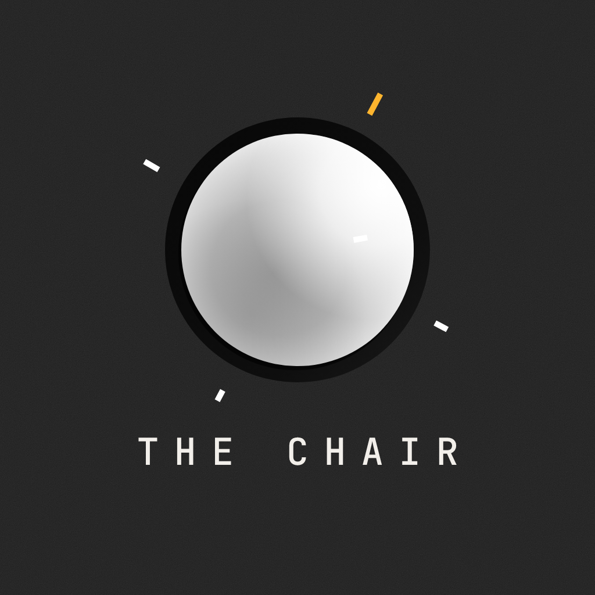

# The Chair — Brand

One glossy sphere in a black well, on graphite with film grain. Monochrome first,
one warm accent, mono type for everything you read at a glance and a refined serif
for the rare big sentence. Sharp edges. Calm motion. Made for families *and* for the
older person in the chair, so it must feel dignified, legible and quiet.

## Palette (`src/theme/tokens.ts`)

| Token | Value | Use |
|---|---|---|
| `colors.bg` | `#1D1D1D` | Graphite background, always with `<Grain />` |
| `brand.black` / `brand.well` | `#0B0B0B` / `#0E0E0E` | Sphere well, day circles, code circles, photo frames |
| `colors.text` | `#F2EFEA` | Warm off-white: text, icons, primary buttons |
| `colors.textMuted` / `textFaint` | 72% / 46% off-white | Secondary text, hints |
| `colors.primary` | `#FFB52E` | THE accent. Short underlines (TODAY, HEARD, active field), progress arc, "in the chair" dot. Never fills, never large areas |
| `colors.tertiary` / `danger` | `#FF6F61` coral | Destructive rows, "release to cancel", errors |
| `colors.secondary` | `#2F5BFF` blue | Reserved for rare celebration moments; unused by default |

No gradient blobs, no orange/violet/mint, no emoji.

## Type

- **Mono — JetBrains Mono** (`@expo-google-fonts/jetbrains-mono`, 400/500/700): labels, titles,
  nav, numbers, body. Labels are UPPERCASE with wide tracking (`Txt variant="label"`).
  Numbers use tabular figures (`variant="number"`).
- **Serif — Instrument Serif** (`@expo-google-fonts/instrument-serif`): big headlines only
  (`variant="display" | "title"`) — welcome, sign-in, "Enter the code.", chair greeting, notes read on the chair.
- Sizes: family-app body ≥ 17px; labels ≥ 13px (day names 12px); chair mode 24–84px.
- All text goes through `src/components/ui/Txt.tsx`. Fonts load in `src/app/_layout.tsx`.

## Shape

- Corner radii 2–6px (`radius.sm 2 · md 4 · lg 6 · xl 8`). Buttons, inputs, sheets, bubbles are rectangles.
- Real circles only where the object *is* a circle: the sphere, day dots, code dots, play buttons, status dots.
- Hairline dividers instead of cards. Underline inputs instead of boxes.

## Components

| Component | File | Notes |
|---|---|---|
| `Sphere`, `ExtrudedCheck` | `ui/Sphere.tsx` | SVG sphere (body + key light top-right + occlusion) in a black well; optional yellow progress arc. Extruded dark check for "complete" |
| `Dashes` | `ui/Dashes.tsx` | Deterministic burst of short white bars + grey squares. Driven by `level` (mic), `burst` (send), `glow` (chair breathing) |
| `Grain` / `ScreenBackground` | `ui/Grain.tsx` | Tiling `assets/grain.png` noise over graphite |
| `TalkSphere` | `family/TalkSphere.tsx` | Home hero: hold to talk, slide away to cancel, release to send |
| `WeekRow` | `family/WeekRow.tsx` | 6 days + TODAY. Complete day = outlined circle with check |
| `HomeTopBar` | `family/HomeTopBar.tsx` | `+ SEND` · NAME ● · `SETTINGS`, icons always carry a plain label |
| `GlossyButton` | `ui/GlossyButton.tsx` | Solid off-white rectangle, black mono label (outline variants for neutral/danger) |
| `Sheet` / `SheetOption` | `ui/Sheet.tsx` | Bottom sheet with large mono option rows |
| `ListRow` / `ListSection` | `ui/ListRow.tsx` | Settings rows with hairline dividers |
| `Icon` | `ui/Icon.tsx` | react-native-svg line icons on a 24 grid, round caps, 2.2–2.4 stroke |
| Chair: `ChairSphere`, `ChairButton`, `PairCodeDisplay`, `NowPlayingOverlay` | `components/chair/` | Same objects, much larger; REPLAY is a huge off-white rectangle |

## Motion & haptics

- Springs are damped (no bounce-y toys). Durations 250–900ms. Nothing loops on the family home at rest.
- **Hold:** sphere sinks 5.5% into the well (spring) + Heavy impact on start, then a Light tick every
  400ms; Medium after 20s; Heavy in the last 15s before the 2-minute cap. Progress arc fills yellow.
  Dashes stretch and push out with the mic level.
- **Slide away (>120px) / up:** sphere half-returns, arc goes grey, label "RELEASE TO CANCEL" (coral).
  Release → Warning haptic, "CANCELLED".
- **Sent:** Success haptic, extruded check springs onto the sphere, dashes drift out ~0.5R and fade over 650ms
  (short and elegant, not confetti). "SENT TO ROSA". Resets after 2.5s.
- **Heard:** when the chair has played your latest message, a quiet "HEARD" with a yellow underline sits under the hint.
- **Chair:** while playing, the sphere breathes on a 3.2s sine cycle with a soft halo; dashes drift gently.
- Web: haptics are no-ops.

## Do / Don't

- **Do** leave lots of empty space; one hero object per screen.
- **Do** pair every icon with a plain-English label where space allows.
- **Do** keep yellow to underlines, dots and the progress arc.
- **Don't** use pills, rounded cards, gradient blobs, emoji, or more than one accent on a screen.
- **Don't** stack cards on the home screen. Don't animate things that aren't responding to the user or to playback.
- **Don't** copy other apps' marks — the sphere, check and dashes here are our own drawings.

## Assets

`assets/icon.png`, `splash-icon.png` (via the `expo-splash-screen` plugin, background `#1D1D1D`),
`android-icon-foreground/background/monochrome.png`, `favicon.png`, `grain.png` — all generated from SVG.
